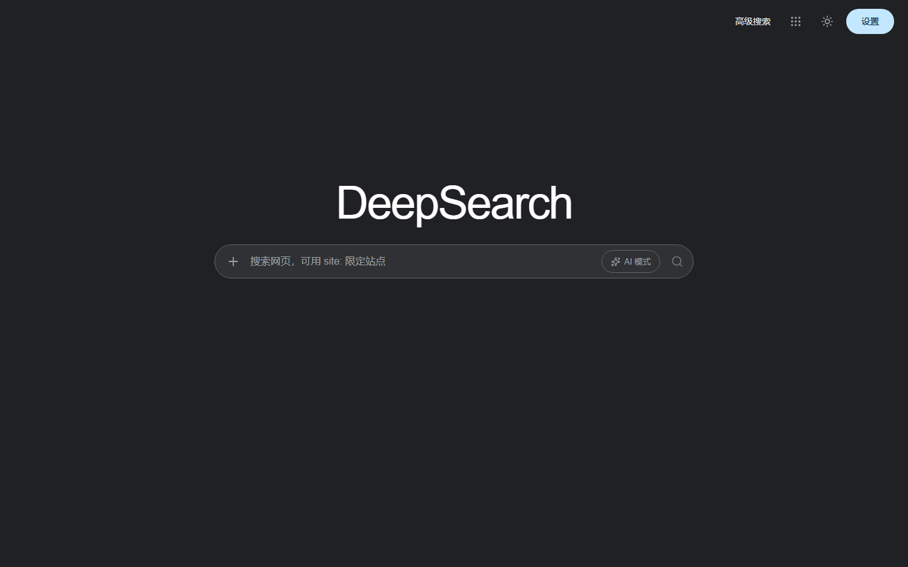
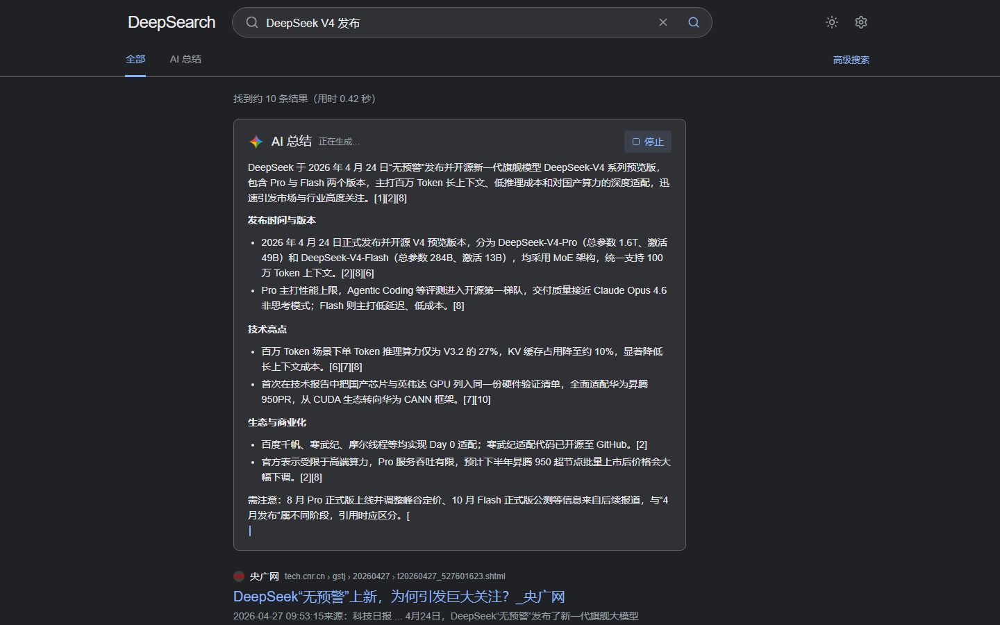
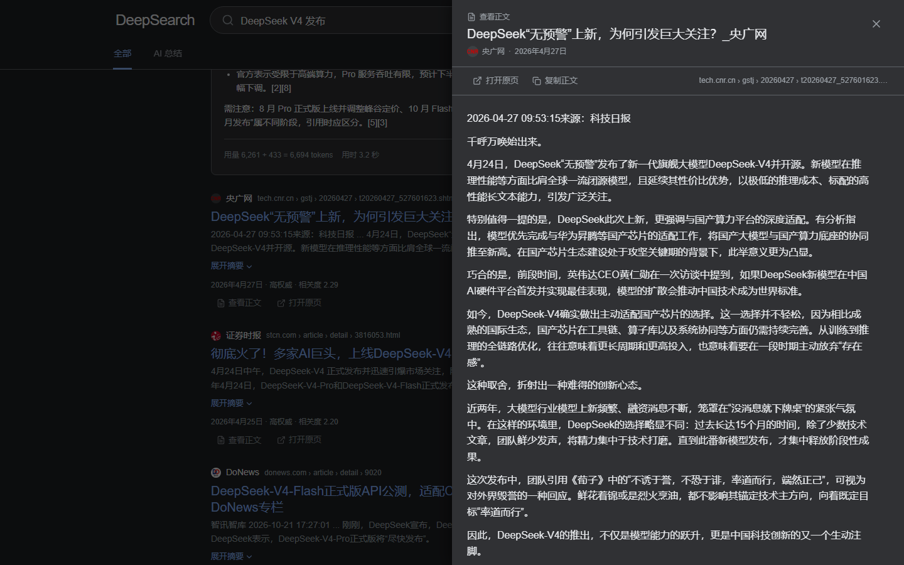
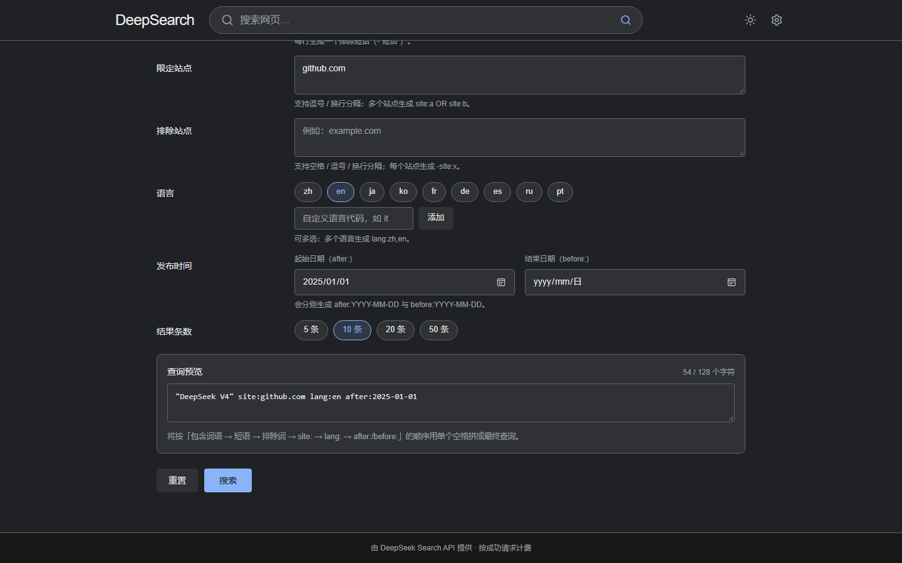
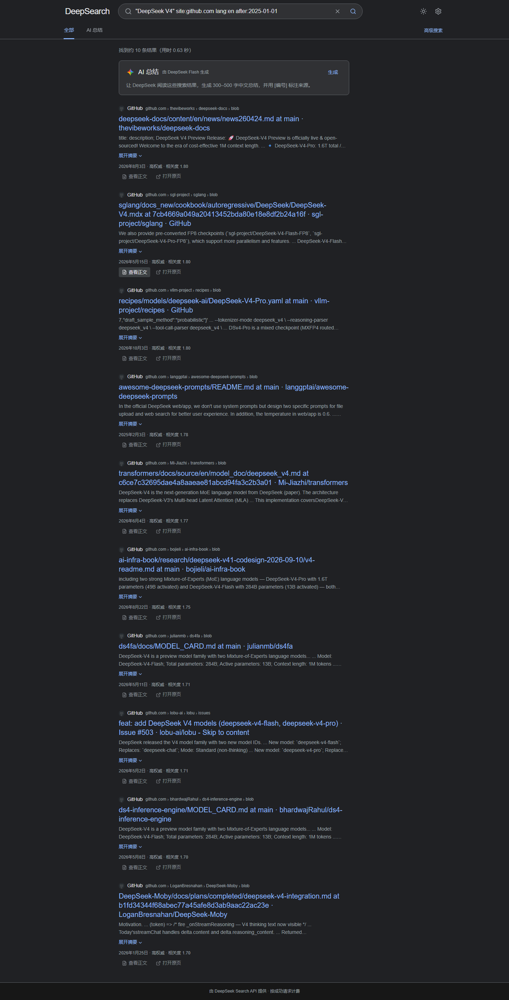
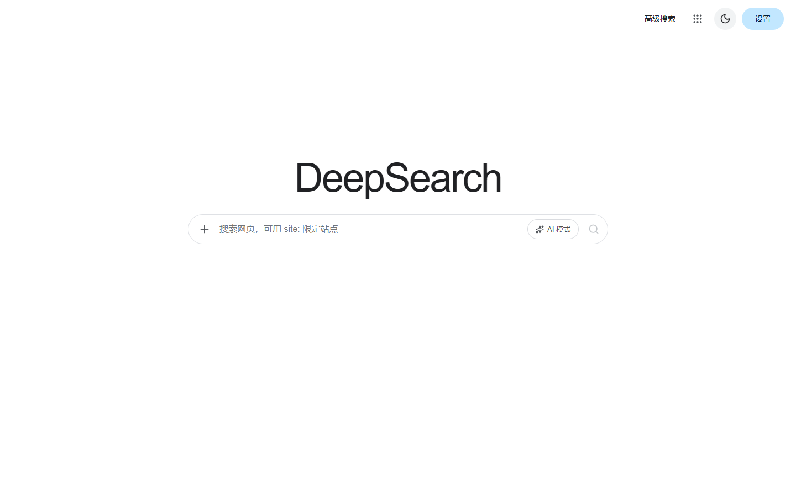
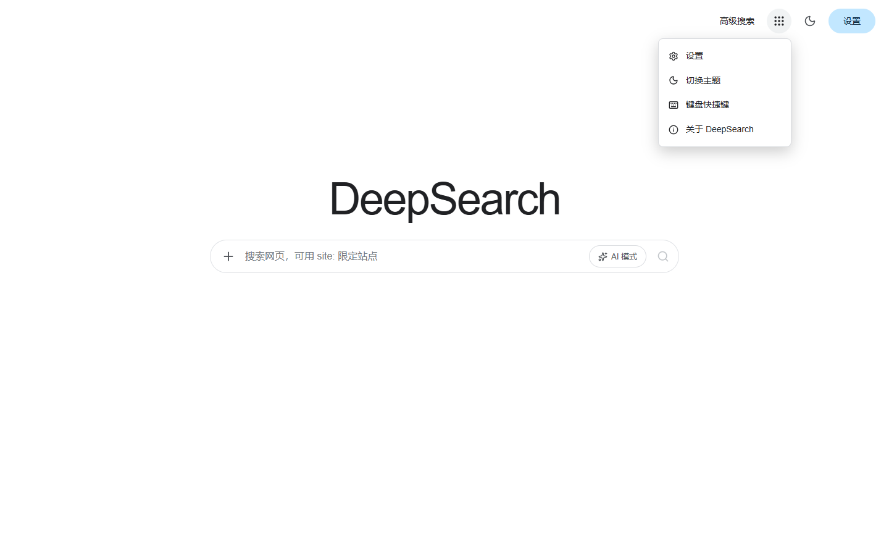

# DeepSearch

一个可以直接部署到服务器的网页搜索引擎：界面是 Google 风搜索页（默认深色 Material Dark，
可切换浅色），检索结果来自
**DeepSeek 官方 Search API**（`POST /v1/tools/search`），支持正文抓取（`/v1/tools/fetch`）
与可选的 AI 总结回答（`/chat/completions`）。

> **为什么需要后端？** DeepSeek API 不允许浏览器跨域直连，且 API Key 不应出现在前端请求里。
> 本项目的 Node 服务只做一层薄代理：访客自己的 Key 仅随请求头透传给 DeepSeek，服务端不保存。

> 📦 **交接文档**：[`HANDOVER.md`](HANDOVER.md)（架构、开发/部署、配置、运维、二次开发、已知限制）

## 功能

- 🔍 **网页搜索**：标题、站点名、日期、短摘要、权威度、相关性排序，支持 DeepSeek 搜索操作符
  （`site:` `-site:` `lang:` `after:` `before:` `"精确短语"` 等，直接输入即可）。
- 🧭 **普通 / 高级搜索**：普通搜索即输即搜；高级搜索页可图形化选择
  `site:`、排除站点、语言、发布时间、精确短语、排除词、结果条数等参数，实时预览生成的查询语法
  （含 128 字符上限校验），提交后复用普通结果页。
- 🤖 **AI 总结**：把前 N 条结果交给 `deepseek-flash` 汇总成带 `[编号]` 引用的中文回答；
  手动 / 自动两种触发模式，SSE 流式输出、可随时停止。
- 📄 **正文阅读**：点击「查看正文」调用 Fetch API 拉取网页 Markdown，在右侧抽屉内阅读，无需跳出。
- 🔑 **访客自带 Key（BYOK）**：每个访客在网页设置里填自己的 DeepSeek API Key，保存在浏览器
  `localStorage`，不同用户互不影响，站点运营者不承担任何 API 费用与密钥风险。
- ✨ **细腻动效**：入场、列表 stagger、骨架屏、流式打字光标、抽屉、Toast 等，尊重
  `prefers-reduced-motion`。
- 🧩 **Google 式首页**：顶栏入口（高级搜索 / 更多菜单 / 设置药丸 / 主题切换）、宽搜索框
  内嵌「AI 模式」开关（开启后搜索完自动生成总结）、左侧「+」直达高级搜索。
- 🌗 **明暗主题**：默认 Google Material Dark 深色主题，右上角一键切换浅色，选择保存在
  浏览器 `localStorage`。
- 🐳 **可部署**：Docker / docker compose / systemd / 直接 `node` 四种运行方式。

## 界面预览

| 首页 | 搜索结果 + AI 总结 |
| --- | --- |
|  |  |

| 正文阅读抽屉 | 移动端 |
| --- | --- |
|  |  |

| 高级搜索 | 高级搜索结果 |
| --- | --- |
|  |  |

| 首页（浅色） | 「更多」菜单 |
| --- | --- |
|  |  |

> 截图由 `pnpm screenshot`（Playwright + 本机 Edge）自动生成，见 `screenshots/`。

## 技术栈

| 层 | 技术 |
| --- | --- |
| 前端 | React 19、TypeScript、Vite 8、framer-motion、react-markdown |
| 后端 | Node.js 24（ESM）、Express 5、compression；零数据库、零额外运行时依赖 |
| 测试 | Vitest 5 + Supertest（全 mock，不消耗真实额度）、Playwright（截图/冒烟） |
| 部署 | 多阶段 Dockerfile、docker compose、systemd unit |

## 目录结构

```text
DeepSearch/
├─ server/                 # 后端（纯 ESM JS）
│  ├─ index.mjs            # 入口：启动、优雅退出
│  ├─ app.mjs              # Express 应用：路由、安全头、SSE、静态托管
│  ├─ deepseek.mjs         # DeepSeek API 客户端（超时/重试/SSE 解析）
│  ├─ config.mjs           # 环境变量与 .env 加载
│  ├─ validation.mjs       # 请求校验
│  ├─ prompt.mjs           # AI 总结 Prompt 构造
│  ├─ rate-limit.mjs       # 按 IP 滑动窗口限流
│  ├─ errors.mjs           # 统一错误与上游状态码映射
│  └─ logger.mjs           # 脱敏日志
├─ web/                    # 前端源码
│  ├─ index.html
│  ├─ vite.config.ts
│  └─ src/                 # components / lib / styles
├─ tests/                  # 后端单元 + 接口测试（fake fetch）
├─ scripts/
│  ├─ e2e-check.mjs        # 真实 API 端到端冒烟（需自备 Key）
│  └─ screenshot.mjs       # Playwright 截图（复用本机 Edge）
├─ screenshots/            # pnpm screenshot 生成的界面截图
├─ docs/API-CONTRACT.md    # 前后端接口契约
├─ Dockerfile
├─ docker-compose.yml
├─ deploy/deepsearch.service
└─ .env.example
```

## 快速开始（本地开发）

要求：**Node.js ≥ 20.19**、**pnpm ≥ 10**（推荐 11）。

```bash
pnpm install
pnpm dev          # 同时启动后端 :8787 与 Vite :5173
```

打开 <http://localhost:5173>，点右上角设置，填入你的 DeepSeek API Key（在
<https://platform.deepseek.com/api_keys> 创建），点击「测试连接」验证后保存即可搜索。

也可以分开启动：`pnpm dev:api`（:8787）与 `pnpm dev:web`（:5173）。

## 生产运行

```bash
pnpm install                 # 安装依赖（构建前端需要 devDependencies）
pnpm build                   # 构建前端到 dist/web
cp .env.example .env         # 按需修改
pnpm start                   # http://0.0.0.0:8787
# 可选：构建完成后只保留运行依赖，减小体积
pnpm prune --prod
```

生产模式下 Express 直接托管 `dist/web`，并支持 `/search?q=...` 深链刷新。

### 方式一：Docker

```bash
docker build -t deepsearch:1.0.0 .
docker run -d --name deepsearch -p 8787:8787 --env-file .env --restart unless-stopped deepsearch:1.0.0
```

### 方式二：docker compose

```bash
docker compose up -d --build
```

### 方式三：systemd（裸机 / 云主机）

```bash
sudo useradd --system --user-group --home /opt/deepsearch --shell /usr/sbin/nologin deepsearch
sudo mkdir -p /opt/deepsearch /etc/deepsearch
sudo rsync -a --exclude node_modules ./ /opt/deepsearch/
# 先以当前用户完成依赖安装与构建（目录需可写），再交给服务用户只读运行
sudo chown -R "$USER":"$USER" /opt/deepsearch
cd /opt/deepsearch && pnpm install --frozen-lockfile && pnpm build && pnpm prune --prod
sudo chown -R deepsearch:deepsearch /opt/deepsearch
sudo cp deploy/deepsearch.service /etc/systemd/system/
sudo cp .env.example /etc/deepsearch/deepsearch.env   # 编辑后
sudo systemctl daemon-reload && sudo systemctl enable --now deepsearch
```

详见 `deploy/README.md`。

### 反向代理

建议前面放 Nginx/Caddy 并启用 HTTPS（**Key 会随请求头发送，必须走 HTTPS**）。示例：

```nginx
location / {
  proxy_pass http://127.0.0.1:8787;
  proxy_http_version 1.1;
  proxy_set_header Host $host;
  proxy_set_header X-Forwarded-For $proxy_add_x_forwarded_for;
  proxy_set_header X-Forwarded-Proto $scheme;
  proxy_buffering off;          # AI 总结是 SSE，必须关闭缓冲
  proxy_read_timeout 300s;
}
```

> 配置反代后请在 `.env` 中设置 `TRUST_PROXY=1`（或填代理网段），否则所有访客会共享同一个
> 代理 IP、容易触发限流；而直连部署（没有反代）必须保持 `TRUST_PROXY=0`。

## 配置

所有配置通过环境变量（或根目录 `.env`）提供，完整说明见 [`.env.example`](.env.example)。

| 变量 | 默认 | 说明 |
| --- | --- | --- |
| `HOST` / `PORT` | `0.0.0.0` / `8787` | 监听地址 |
| `DEEPSEEK_BASE_URL` | `https://api.deepseek.com` | 上游地址 |
| `SEARCH_TIMEOUT_MS` / `FETCH_TIMEOUT_MS` / `CHAT_TIMEOUT_MS` | 20000 / 60000 / 120000 | 上游超时 |
| `MAX_BODY_BYTES` | `1mb` | 请求体大小上限 |
| `RATE_LIMIT_WINDOW_MS` | 60000 | 限流窗口 |
| `SEARCH_RATE_LIMIT_MAX` / `FETCH_RATE_LIMIT_MAX` / `AI_RATE_LIMIT_MAX` | 90 / 30 / 20 | 每 IP 每窗口请求数 |
| `ACCESS_TOKEN` | 空（关闭） | 可选的站点访问口令；设置后访客需在页面输入 |
| `TRUST_PROXY` | `0` | 默认不信任 `X-Forwarded-For`；仅当处在可信反向代理之后才设为 `1`（或代理网段） |
| `LOG_LEVEL` | info | debug/info/warn/error |

**不需要**在服务端配置 DeepSeek API Key —— 这是 BYOK 应用。

## 安全与隐私

- API Key 只存在访客浏览器 `localStorage`，随每次请求的 `Authorization` 头发给本服务，
  服务端仅透传给 DeepSeek，**不落盘、不写日志、不缓存**。
- 开启站点的 `ACCESS_TOKEN` 后，可再加一道访问口令，避免服务被无关用户使用（默认关闭）。
- 所有 `/api/*` 响应 `Cache-Control: no-store`；静态资源启用 CSP、`X-Frame-Options: DENY` 等安全头。
- 部署必须启用 HTTPS：否则访客 Key 会在链路上明文传输。
- **直连部署不要设 `TRUST_PROXY=1`**：否则访客伪造 `X-Forwarded-For` 即可绕过按 IP 限流。
  只有前面存在可信 Nginx/Caddy 时才开启（更稳妥的做法是填代理网段而不是 `1`）。
- 服务端按 IP 限流，避免被脚本刷接口；上游 429 会自动退避重试。

## 费用说明

- Search / Fetch：**每 1000 次成功请求 5 元**；失败请求、空结果不计费。
- AI 总结按 `deepseek-flash` token 计费（输入约 1 元/百万 tokens 起，输出约 4 元/百万 tokens 起，
  空闲时段减半），一次总结通常只有几百 tokens。
- 费用由访客自己的 DeepSeek 账户承担，站点运营者无需垫付。

## 接口

前端只访问同源 `/api/*`，完整字段与错误码见 [`docs/API-CONTRACT.md`](docs/API-CONTRACT.md)：

| 方法 | 路径 | 说明 |
| --- | --- | --- |
| GET | `/api/health` | 探活与能力探测 |
| POST | `/api/validate-key` | 校验访客 Key，返回可用模型 |
| POST | `/api/search` | 网页搜索 |
| POST | `/api/fetch` | 抓取网页 Markdown 正文 |
| POST | `/api/summarize` | AI 总结（SSE 流式） |

## 测试与验证

```bash
pnpm test        # 后端单元 + 接口测试（fake fetch，不花钱）
pnpm typecheck   # 前端类型检查
pnpm build       # 前端生产构建
```

真实 API 端到端冒烟（会消耗少量额度）：

```bash
# 终端 A：启动服务
pnpm start

# 终端 B：设置 Key 后执行
export DEEPSEEK_API_KEY="sk-..."      # PowerShell: $env:DEEPSEEK_API_KEY="sk-..."
pnpm e2e
```

页面截图（复用本机 Edge，无需下载浏览器；把 Key 注入 localStorage 自动跑完搜索/总结/正文流程）：

```bash
pnpm screenshot   # 输出到 screenshots/
```

## 常见问题

**Q：为什么不能直接把前端部署到静态托管（Vercel/OSS）？**
A：浏览器直连 DeepSeek 会被 CORS 拦截，且 Key 会暴露在页面请求里。必须有一个同源后端做代理。

**Q：搜索报 401 / 余额不足？**
A：到设置里检查 Key 是否有效、账户是否有余额；错误提示会直接指向对应操作。

**Q：能改成服务端共用一个 Key 吗？**
A：不建议。当前架构刻意采用 BYOK；若确需共享，可在网关层统一注入 Key 并加访问控制。

## 许可

本项目仅用于学习与自建搜索工具；DeepSeek API 的使用须遵守其服务条款与计费规则。
